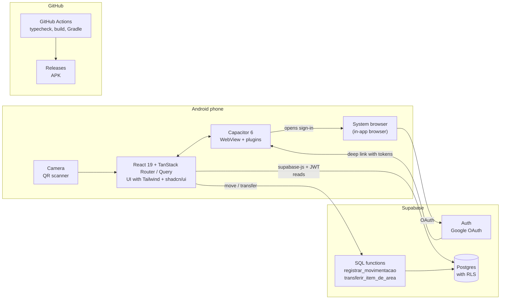
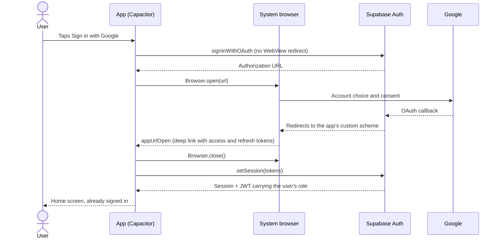
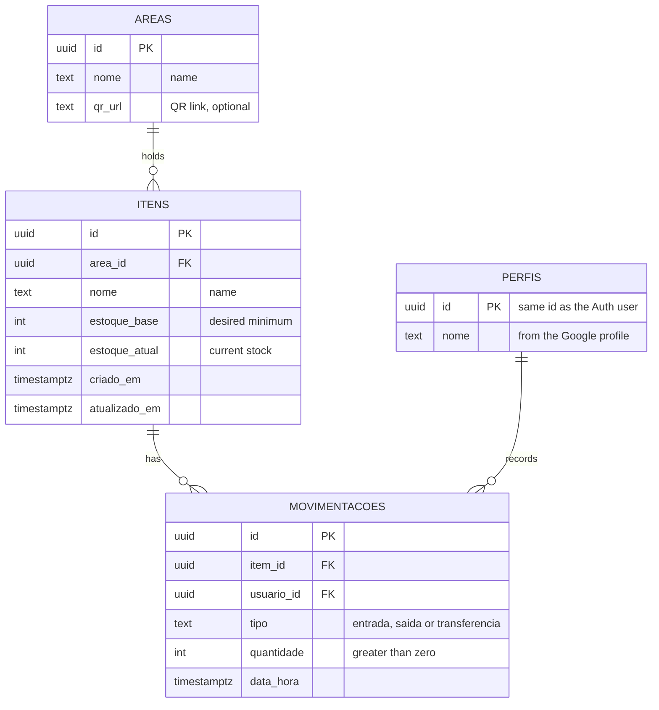

# Inventory App — lab inventory on your phone, driven by QR codes

🇧🇷 [Versão em português](README.md)

## Context

The digital fabrication lab (FabLab) at Samsung Ocean Center Manaus holds hundreds of components, tools
and supplies spread across benches and shelves. Knowing what is there, where it sits and who took what used
to be spreadsheet work. Inventory App moves that to the phone of whoever is in the lab: every physical area
has a QR code, the camera reads it, the person picks the item and logs the stock-in or stock-out on the spot.
At the end of the month, a report shows what moved the most and what is below the minimum stock level.

## Highlights

- **Android app built with Capacitor** on top of a React + TypeScript web codebase; the same code also
  ships as a web SPA.
- **Google sign-in** opened in the system browser (in-app browser) and handed back to the app through a
  **deep link** with a custom scheme; the Supabase session is rebuilt from the returned tokens.
- **One QR code per area**: the app renders the QR as SVG and scans it with the camera (`html5-qrcode`).
  The scanner accepts either the area ID or a link, normalizing the URL before the lookup.
- **Stock-in and stock-out movements** with validation (positive integers only, no withdrawing more than
  what is in stock), written by a database function that updates the balance and logs the history in one go.
- **Role-based access (admin and operator)** taken from the JWT: operators move and register stock; only
  admins delete items and areas and **transfer items between areas**.
- **Item search** across all areas, grouped by name, with the balance per location, a low-stock warning
  and a shortcut straight to the movement form.
- **Monthly report**: items moved, number of movements, **critical** items (below 50% of the base stock)
  and a **"New"** badge for items registered that month.
- **CI on GitHub Actions**: typecheck and build on every PR; every push to `main` builds the APK and
  publishes it as a GitHub Release.

## Architecture

### Google sign-in inside the native app

### Data model

Tables and columns are in Portuguese, as in the real schema. The role (`admin` or `operador`) lives in the
user's metadata and reaches the app inside the JWT.

## Stack

| Layer | Technologies |
|---|---|
| UI | React 19, TypeScript, Vite 7, TanStack Router, TanStack Query, Tailwind CSS 4, shadcn/ui (Radix), lucide-react |
| Mobile | Capacitor 6 (Android), App, Browser and Splash Screen plugins |
| QR code | `qrcode.react` (SVG rendering), `html5-qrcode` (camera scanning) |
| Backend | Supabase: Google Auth, Postgres with RLS, SQL functions called via RPC |
| Quality | Vitest, ESLint, Prettier, `tsc --noEmit` |
| CI | GitHub Actions: typecheck, web build, `cap sync`, Gradle `assembleDebug`, GitHub Release |

## Technical decisions and challenges

- **Sensitive rules live in the database, not in the app.** The UPDATE policy on items had to stay open to
  operators (they edit items). So the area transfer became a `SECURITY DEFINER` SQL function that checks the
  role in the JWT, validates item and area, and runs the UPDATE plus the history entry in a single
  transaction. Hiding the button in the app is just UX; the real barrier is the function.
- **Auditable transfers without breaking the model.** Moving an item to another area does not change stock,
  but it had to show up in the history. The answer was a new `transferencia` type in the movements table,
  with a symbolic quantity of 1 to satisfy the `quantity > 0` constraint and show up in the report without a
  new table.
- **Google sign-in outside the WebView.** Sign-in opens in the system browser and comes back through a deep
  link; the app reads the tokens, closes the browser and sets the session. On the web, the same button uses
  the regular redirect.
- **A separate build for mobile.** The project started from a server-rendered template, which caused
  hydration errors inside Capacitor. A dedicated Vite config produces a plain SPA for Android (and for the
  static web deploy).
- **Caching that fits how the lab works.** Areas and items are cached in TanStack Query and invalidated right
  after each movement or deletion, instead of refetching everything on every tab switch.
- **A pipeline that validates without secrets.** CI falls back to placeholder values when the Supabase
  variables are not set, so every PR still gets typecheck and build; the APK is only built after the merge
  into `main`.

## My role

The repository belongs to the FabLab organization. Out of 63 commits, **39 are mine** (including merges of my
PRs), **19 come from the Lovable bot**, which generated the first UI prototype with sample data, plus 1 from
the Lovable template, and **4 are PR merges** done by the lab's account.

Starting from that prototype, I built:

- the Supabase integration (areas, items, movements and report reading real data);
- the Android packaging with Capacitor, the SPA build for mobile and the splash screen;
- Google sign-in through the in-app browser and deep link;
- role-based access control in the frontend (auth context and `usePermission`);
- moving items between areas, item search and the movement modal;
- the monthly report with critical items and the "New" badge;
- the Vitest tests and the CI pipeline, including the APK published to Releases.

Today, more than 85% of the lines in the three main screens (home, inventory and report) come from my commits.
The work was tracked in tickets and done with the help of AI agents; the decision logs are versioned in the
repository itself.

At the FabLab I also worked at the electronics bench, checking components and PCBs with an LCR meter, and
wrote Python RPA scripts for the lab's registration work.

---

The source code is private (it belongs to the FabLab organization). This page is only a showcase of the project.
Contact: [github.com/roger-mont](https://github.com/roger-mont)
