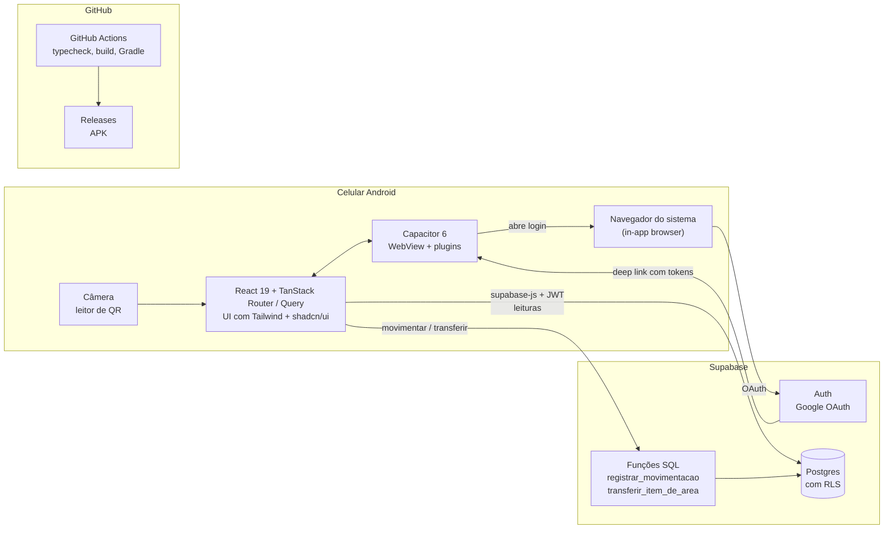
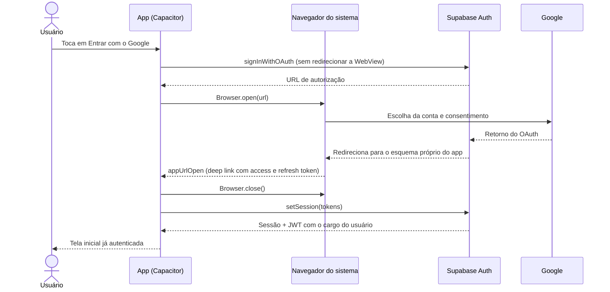
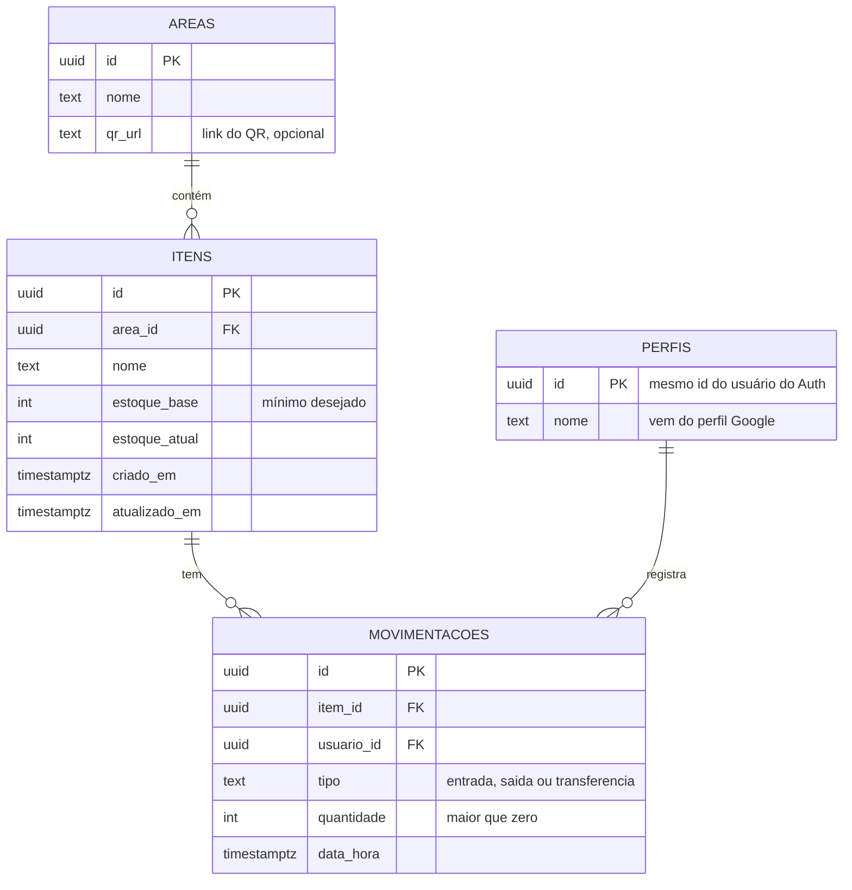

# Inventory App — inventário de laboratório no celular, por QR code

🇺🇸 [English version](README.en.md)

## Contexto

O laboratório de fabricação digital (FabLab) do Samsung Ocean Center Manaus guarda centenas de
componentes, ferramentas e insumos espalhados por bancadas e prateleiras. Saber o que existe, onde
está e quem retirou o quê era trabalho de planilha. O Inventory App leva isso para o celular de quem
está no laboratório: cada área física tem um QR code, a câmera lê o código, a pessoa escolhe o item e
registra a entrada ou a saída na hora. No fim do mês, um relatório mostra o que mais saiu e o que
está abaixo do estoque mínimo.

## Destaques

- **App Android com Capacitor** a partir de uma base web React + TypeScript; o mesmo código também gera
  uma versão web (SPA).
- **Login com Google** aberto no navegador do sistema (in-app browser) e devolvido ao app por
  **deep link** com esquema próprio; a sessão do Supabase é montada a partir dos tokens do retorno.
- **QR code por área**: o app gera o QR em SVG e lê pela câmera (`html5-qrcode`). O leitor aceita tanto
  o ID da área quanto um link, normalizando a URL antes de buscar.
- **Movimentações de entrada e saída** com validação (inteiro positivo, sem retirar mais do que há em
  estoque), gravadas por uma função no banco que atualiza o saldo e registra o histórico de uma vez.
- **Perfis de acesso (admin e operador)** vindos do JWT: o operador movimenta e cadastra; só o admin
  apaga itens e áreas e **transfere itens entre áreas**.
- **Busca de itens** em todas as áreas, agrupada por nome, com saldo por local, alerta de estoque
  crítico e atalho direto para movimentar.
- **Relatório mensal**: total de itens movimentados, número de movimentos, itens **críticos** (abaixo de
  50% do estoque base) e selo **"Novo"** para itens cadastrados no mês.
- **CI no GitHub Actions**: typecheck e build em todo PR; a cada push na `main`, gera o APK e publica
  como GitHub Release.

## Arquitetura

### Login com Google dentro do app nativo

### Modelo de dados

O cargo (`admin` ou `operador`) fica nos metadados do usuário e chega ao app dentro do JWT.

## Stack

| Camada | Tecnologias |
|---|---|
| Interface | React 19, TypeScript, Vite 7, TanStack Router, TanStack Query, Tailwind CSS 4, shadcn/ui (Radix), lucide-react |
| Mobile | Capacitor 6 (Android), plugins App, Browser e Splash Screen |
| QR code | `qrcode.react` (geração em SVG), `html5-qrcode` (leitura pela câmera) |
| Backend | Supabase: Auth com Google, Postgres com RLS, funções SQL chamadas por RPC |
| Qualidade | Vitest, ESLint, Prettier, `tsc --noEmit` |
| CI | GitHub Actions: typecheck, build web, `cap sync`, Gradle `assembleDebug`, GitHub Release |

## Decisões técnicas e desafios

- **Regras sensíveis no banco, não no app.** A política de UPDATE da tabela de itens precisava continuar
  aberta para o operador (ele edita itens). Por isso a transferência entre áreas virou uma função SQL
  `SECURITY DEFINER` que confere o cargo no JWT, valida item e área e faz o UPDATE e o registro no
  histórico na mesma transação. Esconder o botão no app é só experiência de uso; a barreira real é a função.
- **Transferência auditável sem quebrar o modelo.** Mover um item de área não muda estoque, mas precisava
  aparecer no histórico. A saída foi um novo tipo `transferencia` na tabela de movimentações, com
  quantidade simbólica 1, para respeitar a restrição `quantidade > 0` e aparecer no relatório sem tabela nova.
- **Login do Google fora da WebView.** O login abre no navegador do sistema e volta ao app por deep link;
  o app lê os tokens do retorno, fecha o navegador e monta a sessão. Na web, o mesmo botão usa o
  redirecionamento normal.
- **Build separado para o mobile.** O projeto nasceu de um template com renderização no servidor, o que
  causava erro de hidratação dentro do Capacitor. Um config de Vite próprio gera uma SPA pura para o
  Android (e para o deploy web estático).
- **Cache que respeita o uso no laboratório.** A lista de áreas e itens fica em cache no TanStack Query e é
  invalidada logo após cada movimentação ou exclusão, em vez de buscar tudo de novo a cada troca de aba.
- **Pipeline que não depende de segredos para validar.** O CI usa valores de exemplo quando as variáveis
  do Supabase não estão configuradas, então todo PR passa por typecheck e build; o APK só é gerado
  depois do merge na `main`.

## Meu papel

O repositório é da organização do FabLab. Dos 63 commits, **39 são meus** (incluindo merges dos meus PRs),
**19 são do bot do Lovable**, que gerou o protótipo inicial da interface com dados de exemplo, mais 1 do
template do Lovable, e **4 são merges de PR** feitos pela conta do laboratório.

A partir do protótipo, fiz:

- o backend hospedado no Supabase: banco, regras de acesso e funções SQL;
- a integração do app com esse backend (áreas, itens, movimentações e relatório lendo dados reais);
- o empacotamento Android com Capacitor, o build SPA para mobile e a splash screen;
- o login com Google por in-app browser e deep link;
- o controle de acesso por cargo no frontend (contexto de autenticação e `usePermission`);
- a transferência de itens entre áreas, a busca de itens e o modal de movimentação;
- o relatório mensal com itens críticos e o selo "Novo";
- os testes com Vitest e a pipeline de CI, incluindo o APK publicado em Releases.

Hoje, mais de 85% das linhas das três telas principais (início, inventário e relatório) são de commits meus.
O trabalho foi organizado em tickets e feito com apoio de agentes de IA; os logs de decisão ficam versionados
no próprio repositório.

No FabLab também trabalhei na bancada de eletrônica, verificando componentes e placas (PCB) com LCR Meter,
e escrevi scripts de RPA em Python para o cadastro do laboratório.

---

O código-fonte é privado (repositório da organização do FabLab). Esta página é só uma vitrine do projeto.
Contato: [github.com/roger-mont](https://github.com/roger-mont)
